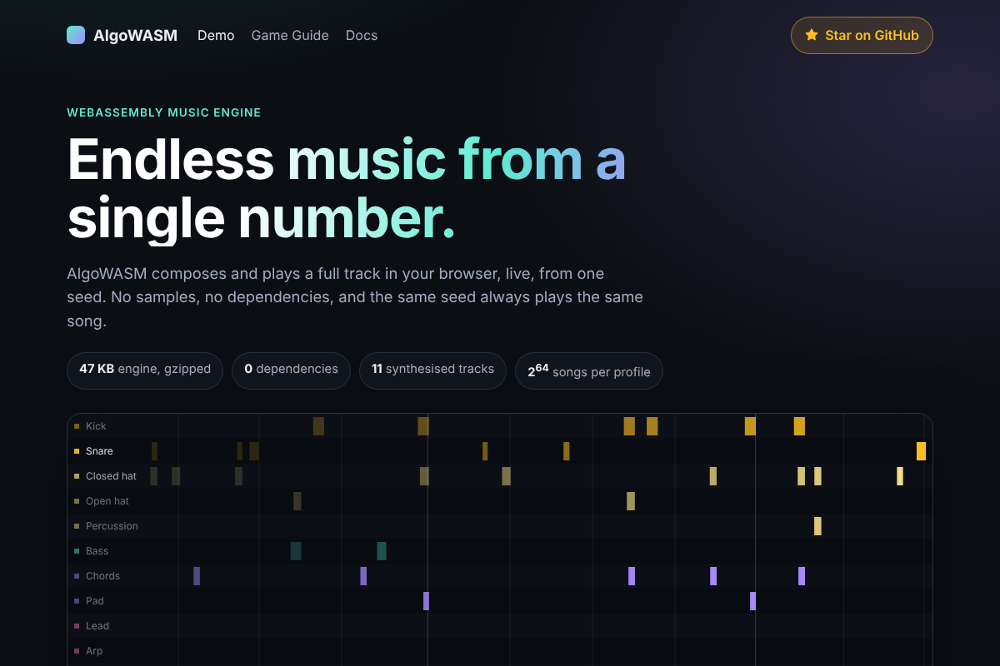

# AlgoWASM

[](https://www.npmjs.com/package/@algo-wasm/algo-wasm)
[](https://github.com/0xe25f/algowasm/actions/workflows/ci.yml)
[](LICENSE)
[](https://github.com/0xe25f/algowasm/stargazers)

**Endless music from a single number.** AlgoWASM composes and plays a full track in the browser, live, from one seed. No samples, no dependencies, and the same seed always plays the same song.

[](https://0xe25f.github.io/algowasm/)

### [▶ Try the live demo](https://0xe25f.github.io/algowasm/)

If you like what you hear, please [⭐ star the repository](https://github.com/0xe25f/algowasm). It costs nothing and helps other developers find it.

## Why AlgoWASM

- **Tiny.** The whole engine is 47 KB gzipped, smaller than one short audio sample.
- **Nothing to licence or host.** Every sound is synthesised live. There are no audio files.
- **Deterministic.** A seed and a style always produce the same song, so every player hears the same soundtrack.
- **Reactive.** Change energy, intensity, mood, or style while it plays. Mute and solo any of the 11 tracks.
- **Beat-accurate events.** Every beat, bar, and section change is reported to your code.
- **No dependencies.** Plain WebAssembly and an AudioWorklet. Works with any framework, or none.

## Quick Start

```sh
npm install @algo-wasm/algo-wasm
```

```ts
import { AlgoWasmPlayer, builtInProfiles } from '@algo-wasm/algo-wasm';

const player = await AlgoWasmPlayer.create({
  wasmUrl: '/algo_wasm.wasm',
  workletUrl: '/algo-worklet.js',
  profile: builtInProfiles.dubstep(),
  seed: 1995n
});

// Browsers only allow audio after a click, tap, or key press.
button.addEventListener('click', () => player.start());

player.on('beat', event => console.log('beat', event.beat));
player.setEnergy(0.9);
```

The two asset files come from the package. [Getting started](docs/getting-started.md) shows where to copy them.

## Where To Go Next

| You want to | Read |
| --- | --- |
| Add music to a page, step by step | [Getting started](docs/getting-started.md) |
| Use it in a LittleJS or three.js game | [Game guide](https://0xe25f.github.io/algowasm/games.html) |
| Use it with React, Vue, Svelte, or Phaser | [Framework integrations](docs/frameworks.md) |
| See every method, option, and event | [API reference](docs/api.md) |
| Choose a style or design your own | [Profiles](docs/profiles.md) |
| Deploy it: MIME types and CSP | [Browser notes](docs/browser.md) |
| Understand how the music is made | [Algorithms](docs/algorithms.md) and [architecture](docs/architecture.md) |
| Check speed and size | [Performance](docs/performance.md) |
| Build, test, or contribute | [Contributing](docs/contributing.md) |
| See what changed | [Changelog](CHANGELOG.md) |

## Browser Support

Current evergreen browsers from 2025 onwards. AlgoWASM needs WebAssembly and AudioWorklet, and has no fallback for older browsers.

## Licence

AGPL-3.0-or-later. See [LICENSE](LICENSE).

Any application that uses this library and is distributed or offered as a network service must make its complete source code available under the same licence.
